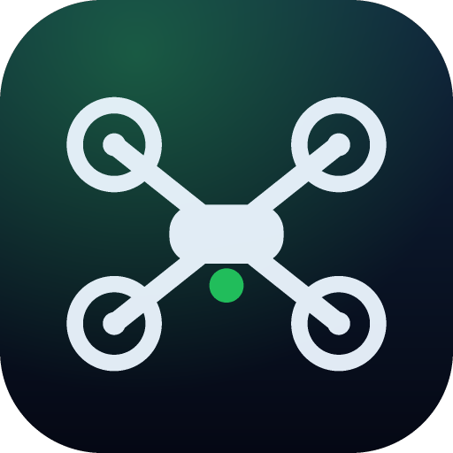

# FlyDrone 🚁

Sistema de condições de voo para drones DJI, feito para **celular** (PWA).
Mostra em tempo real se está **bom para voo** com o drone selecionado, usando
dados da [Open-Meteo](https://open-meteo.com/).



---

## O que ele faz

- **Menu de barrinhas (☰)** com duas seções expansíveis:
  - **Selecione o Drone** — abre a lista: Mini 3, Mini 3 Pro, Mini 4 Pro,
    Mini 5 Pro, Air 3 e Air 3S (mostra o modelo atual logo abaixo do título).
  - **Parâmetros** — unidade do vento (km/h ⇄ m/s) e alerta de rajada
    (70%, 75%, 80% ou 85% do limite DJI; padrão 80%). A escolha do alerta
    fica salva no navegador.
  - Só uma seção fica aberta por vez; a lista de drones já abre expandida.
- **Status geral no topo**: verde “Bom para voo”, amarelo “Voo com atenção”
  ou vermelho “Ruim para voo”, com o motivo principal.
- **Ficha do drone**: toque no **nome do drone** (abaixo do status) para abrir
  a ficha técnica com velocidade máxima, rajada e vento suportados, peso,
  distância máxima e tempo estimado de voo.
- **Grade de 3 quadrados por linha**:
  1. Temperatura
  2. Céu (sol / nublado / chuva…)
  3. Velocidade do vento
  4. Rajadas de vento
  5. Altura das nuvens
  6. Direção do vento (bússola com N/E/S/W e seta verde)
- Cada quadrado fica **verde** quando está bom, **amarelo** quando exige
  atenção e **vermelho** quando está ruim.
- **Unidades**: vento em **km/h** por padrão (menu e tela principal).
  Toque em “Limite …” no cartão do topo para alternar para **m/s**;
  tocando de novo — ou atualizando a página — volta para km/h.
- **Localização**: busca por cidade ou GPS do celular.
- **Próximas horas**: 5 quadrados fixos com vento e rajadas, sempre
  começando na hora atual (ao virar a hora, a lista desliza sozinha).
- **Atualização automática**: os dados são buscados de novo a cada **10 min**
  enquanto o app está aberto. Ao voltar para o app depois de **3 min** fora,
  ele atualiza na hora. Se a busca falhar, tenta de novo só no próximo ciclo.
- Funciona **offline** depois da primeira visita (service worker) e pode ser
  instalado na tela inicial.

---

## Como rodar

### Opção 1 — no PC e no celular (recomendado para testar)

Precisa do [Node.js](https://nodejs.org) instalado.

```bash
cd FlyDrone
node serve.js
```

O terminal mostra dois endereços, por exemplo:

```
No PC:      http://localhost:3000
No celular: http://192.168.0.10:3000
```

Abra o endereço **“No celular”** no navegador do telefone (celular e PC na
mesma rede Wi‑Fi).

> O GPS do navegador só funciona em `https://` ou `localhost`. Pelo IP da rede
> local o botão “Usar minha localização atual” pode ser bloqueado — nesse caso
> use a busca por cidade.

### Opção 2 — publicar de graça

- **Netlify Drop**: arraste a pasta `FlyDrone` em <https://app.netlify.com/drop>.
- **Vercel**: `npx vercel` dentro da pasta.
- **GitHub Pages**: suba os arquivos e ative o Pages.

Com HTTPS o GPS e a instalação como app funcionam normalmente.

### Instalar como app

- **Android/Chrome**: menu ⋮ → “Adicionar à tela inicial”.
- **iPhone/Safari**: botão Compartilhar → “Adicionar à Tela de Início”.

---

## Como a avaliação é feita

Cada drone tem um **limite de vento** (especificação DJI):

| Drone       | Vento máximo        | Temperatura |
|-------------|---------------------|-------------|
| Mini 3      | 39 km/h (10,7 m/s)  | -10 a 40 °C |
| Mini 3 Pro  | 39 km/h (10,7 m/s)  | -10 a 40 °C |
| Mini 4 Pro  | 39 km/h (10,7 m/s)  | -10 a 40 °C |
| Mini 5 Pro  | 43 km/h (12,0 m/s)  | -10 a 40 °C |
| Air 3       | 43 km/h (12,0 m/s)  | -10 a 40 °C |
| Air 3S      | 43 km/h (12,0 m/s)  | -10 a 40 °C |

Ficha técnica mostrada ao tocar no nome do drone (dados oficiais DJI):

| Drone       | Velocidade máx.        | Peso       | Distância máx. | Voo           |
|-------------|------------------------|------------|----------------|---------------|
| Mini 3      | 57,6 km/h              | 248 g      | 18 / 25 km¹    | 38 / 51 min¹  |
| Mini 3 Pro  | 57,6 km/h              | < 249 g    | 18 / 25 km¹    | 34 / 47 min¹  |
| Mini 4 Pro  | 57,6 km/h              | < 249 g    | 18 / 25 km¹    | 34 / 45 min¹  |
| Mini 5 Pro  | 64,8 / 68,4 km/h¹      | 249,9 g    | 21 / 32 km¹    | 36 / 52 min¹  |
| Air 3       | 75,6 km/h              | 720 g      | 32 km          | 46 min        |
| Air 3S      | 75,6 km/h              | 724 g      | 32 km          | 45 min        |

> ¹ Com bateria **Plus**.

Regras aplicadas:

| Item              | Verde            | Amarelo           | Vermelho              |
|-------------------|------------------|-------------------|-----------------------|
| Vento             | até 60% do limite| até 85%           | acima de 85%          |
| Rajadas           | até 80% do limite| até 90%           | acima de 90%          |
| Temperatura       | 5 a 32 °C        | 0–5 ou 32–40 °C   | fora de -10 a 40 °C   |
| Céu               | limpo/parcial    | nublado           | chuva, garoa, nevoeiro, tempestade |
| Nuvens baixas     | acima de 400 m   | 200 a 400 m       | abaixo de 200 m       |
| Visibilidade      | acima de 5 km    | 3 a 5 km          | abaixo de 3 km        |

> A faixa **verde da rajada é ajustável** em ☰ → **Parâmetros**
> (70 / 75 / 80 / 85% do limite DJI). O padrão é 80%, e a faixa amarela
> sempre começa 10 pontos acima do verde (máx. 95%).

> A altura das nuvens é **estimada** pela diferença entre temperatura e ponto
> de orvalho (nível de condensação) e pelas camadas de nuvem da Open-Meteo.
> Quando não há nuvens baixas, o app mostra a camada predominante
> (médias/altas).

**O status geral é o pior item entre todos.** Se qualquer item estiver
vermelho, o topo fica vermelho.

> A faixa da **rajada** (80% do limite para verde) é uma margem de segurança:
> a DJI publica apenas a resistência ao vento sustentado, não um limite de
> rajada. Para o Mini 3 Pro isso significa verde até ~31 km/h, amarelo até
> ~35 km/h e vermelho acima disso.

---

## Estrutura

```
FlyDrone/
├─ index.html            interface
├─ styles.css            estilos (mobile-first)
├─ app.js                lógica, regras de voo e chamadas da API
├─ manifest.webmanifest  configuração do PWA
├─ sw.js                 service worker (funciona offline)
├─ serve.js              servidor local para testar no celular
├─ icons/                ícones do app
└─ tools/
   ├─ gen-icons.js       gera os ícones PNG
   └─ mobile-preview.html preview em viewport de 390px
```

### Adicionar um drone novo

Em `app.js`, no topo:

```js
const DRONES = [
  // ...
  {
    id: 'mavic4', name: 'Mavic 4 Pro', windLimit: 12.0, tempMin: -10, tempMax: 40,
    specs: {
      speed: '90 km/h', speedHint: 'modo S',
      weight: '1063 g',
      distance: '30 km', distanceHint: '',
      flightTime: '51 min', flightHint: '',
    },
  },
];
```

Os campos de `specs` são só para a ficha técnica (texto livre). Se faltar
algum, a linha aparece vazia — o cálculo de voo continua usando apenas
`windLimit`, `tempMin` e `tempMax`. O menu e a ficha se atualizam sozinhos.

---

## Avisos

- Os limites são os **do fabricante** para o drone em condições ideais.
  Vento forte, chuva e nuvens baixas continuam sendo risco real de voo.
- No Brasil, voos acima de **120 m** exigem autorização (ANAC / DECEA).
- Dados meteorológicos por [Open-Meteo](https://open-meteo.com/) (licença
  CC BY 4.0).
